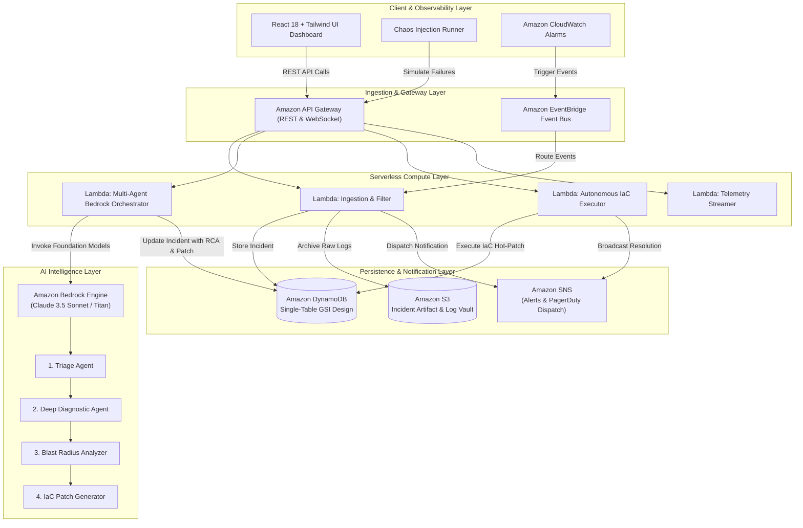

# CloudSentinel AI — System Architecture Deep Dive

## 1. Executive Summary

**CloudSentinel AI** is an autonomous, serverless, multi-agent cloud resilience and security operations platform engineered on AWS. It ingests distributed telemetry streams, detects anomalous failure signatures, executes autonomous root cause analysis (RCA) using **Amazon Bedrock (Claude 3.5 Sonnet / Titan)**, evaluates cascading blast radius across downstream microservices, synthesizes non-destructive **Infrastructure-as-Code (IaC)** patches (Terraform / CloudFormation), and executes 1-click zero-downtime hot-remediations.

---

## 2. High-Level Architecture Diagram

---

## 3. AWS Services Utilization Matrix

| AWS Service | Core Purpose in CloudSentinel AI | Production Resilience Feature |
| :--- | :--- | :--- |
| **Amazon Bedrock** | Autonomous multi-agent reasoning, diagnostic RCA, and IaC synthesis | Multi-model invocation, low latency inference, temperature control |
| **AWS Lambda** | Microservice computation for ingestion, diagnosis, remediation, and metrics | Serverless scale-to-zero, concurrency isolation, sub-50ms warm execution |
| **Amazon DynamoDB** | Single-table persistence for incidents, topology state, and audit logs | Point-In-Time Recovery (PITR), GSI partition queries, SSE encryption |
| **Amazon S3** | Immutable artifact storage for raw incident dumps and IaC code manifests | AES-256 Server-Side Encryption, Block Public Access, Glacier lifecycle tiering |
| **Amazon API Gateway** | Managed RESTful interface with rate limiting, CORS, and request validation | Regional endpoint, throttling burst limits, OpenAPI 3.0 compliant |
| **Amazon SNS** | Immediate incident notification dispatch to SRE on-call engineers | High-throughput topic delivery, webhook Fan-out architecture |
| **Amazon EventBridge** | Event router for CloudWatch alarms and synthetic chaos schedules | Decoupled event bus, dead-letter queue routing |

---

## 4. Multi-Agent Reasoning Pipeline

When an incident or CloudWatch anomaly is ingested, the Bedrock Orchestrator triggers an automated 4-stage chain-of-thought analysis:

1. **Triage Agent**:
   - Ingests the alert threshold, error rate, and p99 latency spikes.
   - Correlates with historical telemetry to eliminate false-positive flapping.
2. **Diagnostic Agent**:
   - Analyzes raw CloudWatch log streams and error traces stored in Amazon S3.
   - Identifies the precise root cause (e.g., hot partition skew, misconfigured IAM policy, Lambda concurrency starvation).
3. **Blast Radius Analyzer**:
   - Traverses the active microservice dependency graph in DynamoDB.
   - Maps downstream cascaded impacts (e.g., API Gateway 504 storms, SQS backlog accumulation).
4. **IaC Patch Generator**:
   - Synthesizes exact, production-safe Terraform or CloudFormation remediation code.
   - Attaches risk ratings, automated rollback guarantees, and health check validation probes.

---

## 5. Security & IAM Least Privilege

- All Lambda functions execute under scoped IAM roles strictly granting permissions only to required DynamoDB table ARNs, S3 bucket ARNs, and SNS topics.
- S3 Buckets enforce `BlockPublicAcls`, `BlockPublicPolicy`, and `AES256` default encryption.
- Zero plaintext secrets stored in code; all configuration driven by AWS environment variables and IAM STS.
